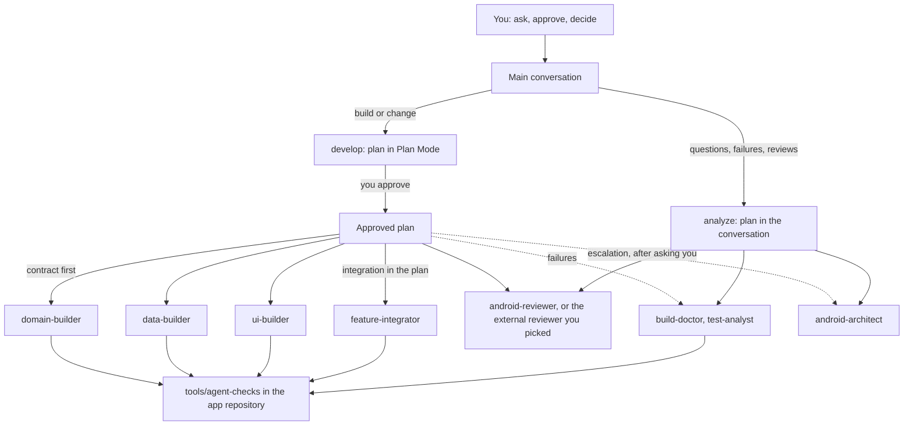

# Android Feature Kit

Agent skills for Claude Code to build an Android feature module layer by layer: navigation, presentation, domain, data, Room and DataStore. On top of the skills, the kit has agents that split the work by layer, two skills that the main conversation uses to coordinate them (`develop` and `analyze`), hooks that keep each agent inside its layer, and check scripts that summarize Gradle output.

The kit works together with a selection of Google's official Android skills. This document says where every skill comes from:

1. [Skills in this kit](#1-skills-in-this-kit): bundled in this plugin.
2. [Official Android skills](#2-official-android-skills): from Google, installed with Android CLI, not bundled.
3. [Work from other authors](#3-work-from-other-authors): what was adapted, what informed an idea, what is a candidate and what was not adopted.

## How the kit works

You talk to Claude as usual. The main conversation coordinates the kit: it reads your request, proposes how to do it, and calls the agents only after you approve.

- Ask to build or change a feature ("add a cancel button to the order detail; the backend has `POST /orders/{id}/cancel`") and the `develop` skill loads. Claude explores within the limits you approved, asks what the code cannot answer, and presents a plan in Plan Mode. No agent writes code until you approve the plan.
- Ask about the code, a failing build or failing tests, or for a review, and the `analyze` skill loads. Claude proposes how it will answer, and you approve it in the conversation.
- `/android-feature-kit:develop` and `/android-feature-kit:analyze` are shortcuts to the same skills. With no task, they ask what you want.

The six layer skills still work on their own. For a small change in one layer, ask for it directly and the matching skill loads, without agents.

Claude decides whether a plain request loads `develop` or `analyze`, from each skill's description and from the routing block in your `CLAUDE.md`. When a request does not load the one you expect, use its shortcut.



| Agent | Writes | Model the plan proposes |
| :--- | :--- | :--- |
| `domain-builder` | The domain package; preloads `domain-layer` | Sonnet |
| `data-builder` | The data package; preloads `data-repository`, loads `data-room` and `data-datastore` when needed | Haiku; Sonnet when the plan includes migrations, sync or refresh policy, conflict resolution or encryption |
| `ui-builder` | Presentation, the feature graph and resources; preloads `feature-ui-compose`, loads `feature-navigation-compose` when needed | Sonnet |
| `feature-integrator` | What lies outside the layers: Gradle, the version catalog, shared providers, the app's NavHost | Sonnet |
| `build-doctor`, `test-analyst` | Nothing; they diagnose failures and name the owner of the fix | Haiku |
| `android-reviewer` | Nothing; the default reviewer | Sonnet |
| `android-architect` | Nothing; it handles escalations | Opus |

Each agent sees only the main conversation's message, never the whole conversation. When it needs a decision, it stops and returns the question; Claude asks you and resumes the same agent.

A brief is proposed when the task creates a module, a screen, an endpoint or an entity, or changes what the user sees (offline behavior, errors, navigation exits, tracking events). A ticket with acceptance criteria is the brief. Otherwise the brief goes in `docs/features/<feature>/<task-id>.md` in the app repository.

### Routing in CLAUDE.md, rules in a file of their own

The kit adds little to the app repository's `CLAUDE.md`, which Claude loads in every session:

- [`claude-md-block.md`](skills/develop/references/claude-md-block.md) is a short block (one paragraph) to paste at the end of `CLAUDE.md`. It says which requests go to `develop`, which go to `analyze`, that a small change in one layer uses the layer skill, and that code changes, small ones included, start only after you approve the plan in Plan Mode.
- [`project-rules.md`](skills/develop/references/project-rules.md) is copied to `.claude/android-feature-kit.md`. `develop` and `analyze` read it only when they start. It holds what you approve once, for every task:
  - Exploration approved in advance: what Claude may read and run without asking while it plans. By default: reading files, searching and read-only git. Builds, test runs, generated maps, the network and agents are asked first.
  - Routine choices: names, file placement, reusing existing helpers and the structure of tests follow the code and are never questions. Everything else is asked.

Edit the lists to fit the repository. Both files are optional. Without the block, the skills still load from their descriptions. Without the rules file, `develop` and `analyze` propose its defaults once per session.

### Rules with IDs

Every layer skill has `references/rules.md`: each of its rules with a stable ID (`DOM-03`, `UI-14`, `NAV-17`), plus the kit-wide `KIT-01` to `KIT-07`. Reviews cite these IDs, and a reviewer reads the rules of the layers a change touches instead of the full skills. Sections needed only in specific cases also live in `references/` and load when the task needs them: navigation migration, custom `NavType`, Room migrations, DataStore encryption.

### The hooks

`hooks/claude-hooks.json` runs two scripts in Claude Code.

`hooks/layer_guard.py` runs before every edit and shell command. It acts on the kit's agents:

- Each layer agent writes only inside its layer's packages; the integrator writes outside the feature modules' sources, plus their manifests; the read-only agents write nothing. Paths are resolved first, so `..` and paths outside the project are blocked.
- Their shell commands must be the Gradle wrapper, read-only git without write or exec options, read-only file tools, Android CLI queries or the kit's check scripts, with no redirection to files, command substitution or PowerShell script blocks.

It also stops every session, the main one included, from writing the plan gate's record (`build/android-feature-kit/approved-plan.json`) and from replacing a scope file that belongs to another session. The kit's agents never write in `build/android-feature-kit/`.

After you approve the plan, `develop` writes the task's feature modules and the session id to `build/android-feature-kit/scope.json`, and deletes the file when it reports. With it, the layer agents write only inside those modules, and the integrator only outside their `src/` folders, except their `AndroidManifest.xml` files; without it, the integrator writes nothing. A project can replace the layer patterns in `.claude/android-feature-kit.json` (see the docstring of `layer_guard.py`).

`hooks/plan_gate.py` runs before Claude launches an agent and after you approve a plan in Plan Mode:

- One kit run per checkout. While `scope.json` belongs to another session, no writing agent can start and Claude cannot replace the file. Claude tells you; if that run is over, you delete the file (for example with `! rm build/android-feature-kit/scope.json`).
- The plan gate, off by default. With `{"planGate": true}` in `.claude/android-feature-kit.json`, approving a plan in Plan Mode records the agents on the plan's `Agents:` line, including your edits to the plan, and a writing agent that the plan approved in this session does not list, or that would run on another model than the plan gives it, is blocked. It has unit tests but has not run in a live session yet, which is why it is opt-in.

Both hooks need Python 3.8 or later; without Python they let calls through. They are guardrails, not a sandbox. They block the usual ways an agent writes files through the shell, but Gradle runs the project's own build logic, and a determined command can find other ways. The app repository's own checks (pre-commit, CI) remain the boundary.

### Check scripts

[`repo-tools/agent-checks`](repo-tools/agent-checks/README.md) has `gradle_summary.py` and `test_summary.py`. They turn Gradle output and JUnit reports into a short JSON summary that agents, people and CI read the same way, and keep the raw log as evidence. They belong in the app repository at `tools/agent-checks/`; the install script copies them there with `--with-repo-tools`.

### External reviewer

`android-reviewer` reviews by default. Any command-line tool can review instead, if it reads a prompt on standard input and returns JSON that follows [`review.schema.json`](skills/develop/references/review.schema.json). Configure it in the app repository's `.claude/android-feature-kit.json`, for example for Codex:

```json
{
  "reviewer": {
    "name": "Codex",
    "command": ["codex", "exec", "-s", "read-only", "--output-schema", "{schema}", "-o", "{output}", "-"]
  }
}
```

The plan offers it next to `android-reviewer`, and you pick. [`run_review.py`](skills/develop/references/run_review.py) runs one round and checks that the answer follows the schema and repeats the change's identity; [`external-review.md`](skills/develop/references/external-review.md) has the configuration and the prompts. Each round is tied to the exact change by `skills/develop/references/review_target.py` (the commit plus a hash of the staged, unstaged and untracked changes), and a READY verdict counts only while that hash still matches.

## How the kit decides

The kit proposes and you decide. Before anything writes code, you see a plan and approve it. The rules below are what `develop` uses to build that plan, and behind them are the design decisions about how the kit is built. Both are written down here, so you can predict what the plan will propose and change a rule on purpose.

You decide what the code cannot answer: behavior, scope, external contracts, every product question, and every technical choice outside the routine list. The kit never answers those for you.

### When you are asked

| Moment | What you approve | Where |
| :--- | :--- | :--- |
| Before exploring | The exploration approved in advance, once: `.claude/android-feature-kit.md`, or once per session without it | The conversation |
| Before any agent writes | The plan: goal, modules, decisions, brief, agents and their models, integration, checks, reviewer and round cap | Plan Mode |
| Analysis | Which agent or tool answers, on which model, and what it runs | The conversation |
| During the task | Anything the plan did not include: a contract change, a new dependency or version, a fix outside the plan, an agent that asks for a larger model, an escalation to `android-architect` | The conversation |
| After each review round | Which findings get fixed, the ones Claude would dispute or defer, and any round beyond the cap | The conversation |

### What the plan proposes

**Which agents.** `develop` reads just enough to plan (`settings.gradle.kts`, the module's package layout, `git status`, the ticket) and proposes only the agents the task needs, on a line that starts with `Agents:`:

- A bug in one layer needs only that layer's agent.
- When the contract changes (models, errors, repository interfaces, use case signatures), `domain-builder` runs first, and its `CONTRACT_CHANGES` is what the others build against.
- `data-builder` and `ui-builder` run in parallel when both are needed.
- `feature-integrator` is in the plan when integration is known up front. Items the agents report later (`OUTSIDE_MODULE`, `DEPENDENCIES`) that the plan does not cover are asked first.

**A small change.** One layer, no contract change, no new module, screen, endpoint, entity or dependency: the plan proposes doing it in the main conversation with that layer's skill, without agents.

**Whether to write a brief.** The plan proposes a brief when the task creates or changes any of these:

1. a feature module that is not yet in `settings.gradle.kts`;
2. a new screen or destination in the graph;
3. a new endpoint, entity or table;
4. what the user sees of something that exists: offline or cache behavior, how errors show, navigation exits, tracking events.

Bugs whose expected behavior is already clear, refactors and visual tweaks get no brief. For a bug whose expected behavior is ambiguous, the plan proposes writing your decision down before anyone implements it. A ticket with acceptance criteria is the brief. Without one, the brief goes in `docs/features/<feature>/<task-id>.md` and holds only the goal, observable acceptance criteria, open decisions and the contracts that apply.

**What is asked.** Agents take conventions from one or two files in the same package of the module, or of a neighboring feature. The routine choices in `.claude/android-feature-kit.md` are never questions. What the code cannot answer (behavior, offline handling, scope, the endpoint, the events, a new public interface or dependency, a migration strategy) is asked in one round before the plan. Subagents cannot ask you directly, so an agent that needs a decision stops with `STATUS: blocked` and the question, Claude asks you, and the same agent resumes with its context.

**Which model.**

| Role | Proposed model | Proposed differently when |
| :--- | :--- | :--- |
| `domain-builder`, `ui-builder`, `feature-integrator`, `android-reviewer` | Sonnet | Claude has a reason, and says it in the plan |
| `data-builder` | Haiku | Sonnet when the plan includes a Room migration or schema change, sync or refresh policy, conflict resolution or encryption. If the agent replies `ESCALATE_TIER: yes` or fails twice on the same task, Claude asks you before moving it to Sonnet |
| `build-doctor`, `test-analyst` | Haiku | Claude has a reason, and says it in the plan |
| `android-architect` | Opus | Called only on escalation, after asking you |

**When to escalate.** Claude asks you before calling `android-architect` when the same error survives two fixes, when a diagnosis says `ESCALATE`, when a review finding is a design problem, or when two agents need contradictory contracts. A missing product decision goes to you, not to a larger model.

**Where each agent may write.** The layer guard holds each agent to the scope file:

| Agent | May write |
| :--- | :--- |
| `domain-builder`, `data-builder`, `ui-builder` | Their own layer's packages (and, for `ui-builder`, resources), only inside the scoped modules |
| `feature-integrator` | Anywhere in the project except the scoped modules' `src/`, apart from their `AndroidManifest.xml` files; nothing at all without the scope file |
| `build-doctor`, `test-analyst`, `android-reviewer`, `android-architect` | Nothing |

**When a review counts.** You pick the reviewer and the maximum number of rounds in the plan. Every round carries the change's identity: a run id, the round, the commit, a hash of the staged, unstaged and untracked changes, and the kit version (`skills/develop/references/VERSION`). Claude accepts READY only if the answer repeats that identity and the commit and hash still match the code. After each round you decide which findings get fixed. The review stops at READY with passing checks, or when the approved rounds are used up.

### Why the kit is built this way

These decisions come from design debates between the maintainer, Claude and Codex in November 2026. The maintainer made the final call on each one.

| Decision | Reason | Considered instead |
| :--- | :--- | :--- |
| The main conversation coordinates | It is how Claude Code delegates: the main conversation picks agents from their descriptions and from routing rules in `CLAUDE.md`. Subagents cannot ask you questions, and the coordinator has to. | An orchestrator agent; a session started with `--agent`; agent teams, which are experimental and meant for agents that coordinate among themselves; dynamic workflows, which take no input from you while they run |
| Plain requests load the flow, and the commands are shortcuts | You describe the work as you would to a teammate. Skills load from their descriptions, and a short block in `CLAUDE.md` adds the routing. | Entry skills that run only when invoked (0.3.0) |
| Nothing writes before you approve the plan | Agents pause for human judgment at checkpoints and blockers, as Anthropic's guidance on orchestrator and worker agents describes. In 0.3.0 the flow chose the brief, the models, the escalations and the review on its own. | A fixed procedure that decides by itself |
| Plan Mode for implementation, the conversation for analysis | Plan Mode keeps edits blocked until you approve; an analysis changes no source. | Plan Mode always, or the conversation always |
| Exploration and routine choices are approved once | Reading the code to plan and following its names are not decisions. Asking about them every time turns each task into a questionnaire. | Asking before any exploration, and about every choice |
| Only the routing goes in `CLAUDE.md` | `CLAUDE.md` belongs to the whole team and loads in every session. The limits and routine choices live in `.claude/android-feature-kit.md`, which the skills read only when they run. | The whole block in `CLAUDE.md`; a one-line import of the block, which still loads it in every session; nothing in `CLAUDE.md` |
| The plan gate is optional | Instructions alone do not enforce approval, but a permission prompt on every launch repeats the approval you already gave. The gate checks each launch against the approved plan, and stays off until it has run in real sessions. | Instructions only; a permission prompt for every writing agent |
| One kit run per checkout | The scope file belongs to the checkout, so two runs would overwrite each other's scope. | Several runs, each with its own scope |
| One plugin with two coordinating skills | Whether a task needs a brief depends on the task, and whether it writes depends on the agent's tools; neither follows a plugin boundary. The reviewer needs the same rules the builders follow. | One plugin to develop and one to analyze |
| Layer agents, called only when needed | Each agent loads only its own skill, so a bug in one layer pays for one skill instead of all of them. | One implementer that loads every skill |
| The domain contract goes first | Data and UI build in parallel against code that compiles, not against a document. | A spec document as the handoff |
| A brief only when behavior is created or changed | A bug fix or an explanation needs no spec, and a ticket with acceptance criteria already is one. | A spec for every task, or none at all |
| Data runs on Haiku by default | Most data work is routine: data sources, repository implementations, mappers. The plan proposes Sonnet for the risky cases. | Sonnet for all data work |
| Rules with stable IDs in `references/` | A reviewer reads only the rules of the layers a change touches, and every finding names the rule it breaks. | Reviewers reading every full skill |
| The layer guard is a plugin hook | Plugin agents ignore hooks in their own frontmatter, and a plugin hook sees which agent made each call. | Hooks declared per agent |
| The app repository's checks are the real boundary | The hooks are guardrails: Gradle runs the project's own build logic. | Relying on the hooks alone |
| The external reviewer is optional, and any tool can be one | Not every developer has Codex, and a reviewer from another model family catches mistakes the author's model misses. Any tool that returns the review schema fits, and you pick it per task. | Codex required; Codex selected whenever it was installed (0.3.0) |
| Claude Code only | The kit is built on Claude Code's agents, Plan Mode and hooks that know which agent made a call. Codex stays useful as an external reviewer. | Shipping the plugin for Codex too |
| Check scripts live in the app repository | Agents, people and CI read the same short summaries of Gradle and test output. | Each agent reading raw logs |
| Your own tools are used as they are | android-module-map and the dependency tools keep their logic in their own repositories; the kit calls them when they are installed and never re-implements them. | Copying their logic into the kit |
| No model router | Each role has a default model that the plan proposes and you approve. The only rule-based choice left is data on Haiku or Sonnet. | A separate model that picks the model per task |

## 1. Skills in this kit

| Skill | Use it for |
| :--- | :--- |
| [`develop`](skills/develop/SKILL.md) | Coordinates the layer agents to build or change a feature, after you approve the plan in Plan Mode; loads from a plain request or `/android-feature-kit:develop` |
| [`analyze`](skills/analyze/SKILL.md) | Searches, explains, diagnoses and reviews without changing source; loads from a plain request or `/android-feature-kit:analyze` |
| [`feature-navigation-compose`](skills/feature-navigation-compose/SKILL.md) | Feature graphs, routes, exit callbacks, results and back handling with Navigation Compose 2 type-safe routes; migrating a module to that pattern |
| [`feature-ui-compose`](skills/feature-ui-compose/SKILL.md) | Screen contracts (UiState, UiAction, SideEffect), MVI ViewModels by interface delegation, stateful and stateless Compose screens, previews |
| [`domain-layer`](skills/domain-layer/SKILL.md) | Pure Kotlin use cases, business rules, domain models, repository interfaces and domain errors with the project's own `Either` |
| [`data-repository`](skills/data-repository/SKILL.md) | Offline-first repositories, remote data sources, DTOs, mappers, error mapping, sync rules, Hilt bindings |
| [`data-room`](skills/data-room/SKILL.md) | Room 3 (and Room 2) entities, DAOs, transactions, schema export, migrations and migration tests |
| [`data-datastore`](skills/data-datastore/SKILL.md) | Preferences and typed DataStore, the DataStore 1.3 builder, corruption policy, encryption with `datastore-tink` |

### Conventions the skills assume

These are fixed decisions; the skills do not discuss them:

- Each feature is one Gradle module, and its layers are packages inside it (`presentation`, `domain`, `data`).
- The domain package depends on nothing in data or presentation and on nothing Android.
- The project has its own `Either` type, used from the network layer up.
- MVI by interface delegation: the ViewModel implements the MVI contract `by mvi(initialState)`, and a `CollectSideEffect` composable collects side effects.
- ViewModels talk to use cases only.
- Offline-first data, Hilt, and Navigation Compose 2 (not Navigation 3).

The skills read the project for the concrete names (the `Either` API, the MVI delegate, the network helper, the design system) instead of inventing them.

### Where each skill comes from

| Skill | Origin | Built from |
| :--- | :--- | :--- |
| `feature-navigation-compose` | Original team pattern by pfranccino | Checked against the official guides on [type-safe navigation](https://developer.android.com/guide/navigation/design/type-safety), [multi-module navigation](https://developer.android.com/guide/navigation/integrations/multi-module), [navigation testing](https://developer.android.com/guide/navigation/testing/compose) and the [`SavedStateHandle` reference](https://developer.android.com/reference/kotlin/androidx/lifecycle/SavedStateHandle) |
| `feature-ui-compose` | Written for this kit | [UI layer](https://developer.android.com/topic/architecture/ui-layer), [UI events](https://developer.android.com/topic/architecture/ui-layer/events) and [Hilt release notes](https://developer.android.com/jetpack/androidx/releases/hilt) (`hiltViewModel` package). Points to the official `jetpack-compose-performance` skill for stability rules instead of repeating them |
| `domain-layer` | Written for this kit | [Domain layer](https://developer.android.com/topic/architecture/domain-layer) guide |
| `data-repository` | Written for this kit | [Data layer](https://developer.android.com/topic/architecture/data-layer) and [offline-first](https://developer.android.com/topic/architecture/data-layer/offline-first) guides. Independently written; the idea of the repository as the boundary where technical errors become domain errors was informed by the `android-data-layer` skill in [rcosteira79/android-skills](https://github.com/rcosteira79/android-skills) |
| `data-room` | Written for this kit | [Room guide](https://developer.android.com/training/data-storage/room), [migrations](https://developer.android.com/training/data-storage/room/migrating-db-versions), [Room 3 release notes](https://developer.android.com/jetpack/androidx/releases/room3) and the Room 3 API reference (`Migration`, `MigrationTestHelper`, `RoomDatabase.Builder`, `useReaderConnection`) |
| `data-datastore` | Adapted | Storage choice, read errors, corruption handling, serializer structure and the single-instance rule are adapted from the `datastore` skill in [rcosteira79/android-skills](https://github.com/rcosteira79/android-skills), which is itself adapted from [Meet-Miyani/compose-skill](https://github.com/Meet-Miyani/compose-skill). Both MIT; notices in [`NOTICE.md`](skills/data-datastore/NOTICE.md). Extended with the [DataStore guide](https://developer.android.com/topic/libraries/architecture/datastore), the [DataStore 1.3 release notes](https://developer.android.com/jetpack/androidx/releases/datastore) and the `DataStore.Builder`, `FileStorage` and `AeadSerializer` references |

### How they were reviewed

Claude wrote and Codex reviewed, in three rounds of debate with web search against the official documentation. Codex raised 20 findings; all were resolved before release. Examples of what changed:

- Results returned through `SavedStateHandle` are cleared with `savedStateHandle[KEY] = null`, because `remove` detaches the flow and the next result never arrives.
- Room 3.0.3 is the minimum version, and `useReaderConnection` works with a `Transactor`, not a `SQLiteConnection`.
- Refreshes and mutations of the same resource share a lock, so a slow refresh cannot overwrite a newer change.
- Encrypted DataStore files are excluded from backup, because the Keystore key does not travel with the backup.

## 2. Official Android skills

From [github.com/android/skills](https://github.com/android/skills) (Apache-2.0), maintained by Google and updated often. They are **not bundled** in this plugin: they are installed with [Android CLI](https://developer.android.com/tools/agents/android-cli), so `android skills update` keeps them current. The list lives in [`pack/official-skills.txt`](pack/official-skills.txt).

| Skill | Use it for |
| :--- | :--- |
| `android-cli` | Using Android CLI: SDK, emulators, running the app, UI inspection, Compose preview rendering, docs search |
| `testing-setup` | Testing strategy and setup: unit, UI, screenshot and end-to-end harnesses |
| `jetpack-compose-performance` | Diagnosing recomposition, stability, lazy layouts and rendering performance |
| `edge-to-edge` | System bars, insets and IME handling for edge-to-edge UI |
| `android-intent-security` | Securing intents, exported components and pending intents |
| `android-permissions-security` | Runtime permissions and permission-related risks |
| `anr-audit-and-fix` | Finding and fixing ANRs |
| `android-profiler` | Recording and analyzing Perfetto traces and heap dumps |
| `r8-analyzer` | Auditing R8 configuration and keep rules |

Install `agp-9-upgrade` only when the project upgrades the Android Gradle Plugin.

Not recommended with this kit:

- `navigation-3` and `adaptive`: they move the app to Navigation 3, and this kit uses Navigation 2.
- `migrate-xml-views-to-jetpack-compose` and `ios-to-android`: for migrating legacy code.
- Device-specific skills (Wear OS, TV, XR, cars, camera, widgets): only if the app targets them.
- The official `android-skills` plugin for Claude Code or Codex: it installs all of Google's skills at once, including the two above.

## 3. Work from other authors

### Adapted into this kit

| Source | Author | License | Used in |
| :--- | :--- | :--- | :--- |
| [`datastore` skill](https://github.com/rcosteira79/android-skills/blob/fa39ae26f224/plugins/android-skills/skills/datastore/SKILL.md) | Ricardo Costeira | MIT | `data-datastore` |
| [compose-skill](https://github.com/Meet-Miyani/compose-skill/tree/5841d1e146d2), through the `datastore` skill above | Meet Miyani | MIT | `data-datastore` |

Their notices travel with the skill in [`skills/data-datastore/NOTICE.md`](skills/data-datastore/NOTICE.md) and are repeated in [THIRD_PARTY_NOTICES.md](THIRD_PARTY_NOTICES.md).

### Informed an idea, no text copied

| Source | Author | Idea |
| :--- | :--- | :--- |
| [`android-data-layer` skill](https://github.com/rcosteira79/android-skills) | Ricardo Costeira | The repository is where technical errors become domain errors (`data-repository`) |

### Candidates, not installed

| Source | Author | License | When to consider it |
| :--- | :--- | :--- | :--- |
| [android-testing-skills](https://github.com/skydoves/android-testing-skills) | Jaewoong Eum (skydoves) | Apache-2.0 | When the team writes Compose UI tests and adb-based checks |
| [compose-rules](https://github.com/mrmans0n/compose-rules) | Nacho Lopez | Apache-2.0 | Lint rules for ktlint or detekt; not a skill, but enforces Compose conventions on every build |

### Evaluated and not adopted

These are team-fit decisions, not defects in those projects.

| Source | Author | License | Why not |
| :--- | :--- | :--- | :--- |
| [android-agent-skills](https://github.com/piyushverma0/android-agent-skills) | Piyush Verma | MIT | Its Room skill covers Room 2 only (no Room 3) and wraps DAO calls in `withContext(Dispatchers.IO)`, which Room's `suspend` functions make unnecessary |
| [Skills](https://github.com/PL-Coding-GmbH/Skills) | PL Coding GmbH (Philipp Lackner) | MIT | Built on Koin and Ktor, and names navigation callbacks by destination (`onNavigateToEditor`), which this kit forbids |
| [compose-performance-skills](https://github.com/skydoves/compose-performance-skills) | Jaewoong Eum (skydoves) | Apache-2.0 | Overlaps the official `jetpack-compose-performance` skill |
| [compose-skill](https://github.com/Meet-Miyani/compose-skill) | Meet Miyani | MIT | Oriented to Compose Multiplatform. Its eval suite is a good model for evaluating this kit later |
| [compose-skill](https://github.com/aldefy/compose-skill) | Adit Lal | MIT, with Apache-2.0 material from AOSP | One large skill with many references; useful to read, too broad to install |
| [awesome-android-agent-skills](https://github.com/new-silvermoon/awesome-android-agent-skills) | Sagar Das | Apache-2.0 | General-purpose skills (its data layer skill has 51 lines) that do not follow this kit's conventions |

## Install

### 1. The plugin (once per developer, for all projects)

In Claude Code:

```
/plugin marketplace add pfranccino/pfranccino-dev-skills
/plugin install android-feature-kit@pfranccino-dev-skills
```

Then, in each app repository, paste [`skills/develop/references/claude-md-block.md`](skills/develop/references/claude-md-block.md) at the end of its `CLAUDE.md`, and copy [`skills/develop/references/project-rules.md`](skills/develop/references/project-rules.md) to `.claude/android-feature-kit.md` and adjust its lists (see [Routing in CLAUDE.md, rules in a file of their own](#routing-in-claudemd-rules-in-a-file-of-their-own)). Both are optional.

### 2. The official skills (once per machine)

Install [Android CLI](https://developer.android.com/tools/agents/android-cli) and open a new terminal:

| System | Command |
| :--- | :--- |
| Windows (`cmd.exe`) | `curl -fsSL https://dl.google.com/android/cli/latest/windows_x86_64/install.cmd -o "%TEMP%\i.cmd" && "%TEMP%\i.cmd"` |
| macOS, Apple silicon | `curl -fsSL https://dl.google.com/android/cli/latest/darwin_arm64/install.sh \| bash` |
| macOS, Intel | `curl -fsSL https://dl.google.com/android/cli/latest/darwin_x86_64/install.sh \| bash` |
| Linux x86-64 | `curl -fsSL https://dl.google.com/android/cli/latest/linux_x86_64/install.sh \| bash` |

Then clone this repository and run the script from its root:

```powershell
# Windows
.\plugins\android-feature-kit\scripts\install-pack.ps1
```

```bash
# macOS or Linux
bash plugins/android-feature-kit/scripts/install-pack.sh
```

Without a project path, the script installs the official skills globally for Claude Code and Codex. It runs `android skills add --agent=claude,codex <id>` for each skill in [`pack/official-skills.txt`](pack/official-skills.txt), so you can also run those commands by hand.

### Alternative: everything inside an app repository

Use this when the skills must travel with the app repository, for example for CI agents or teammates who do not install the plugin:

```powershell
# Windows
.\plugins\android-feature-kit\scripts\install-pack.ps1 -Project C:\code\my-app -WithTeamSkills
```

```bash
# macOS or Linux
bash plugins/android-feature-kit/scripts/install-pack.sh --project ~/code/my-app --with-team-skills
```

This installs the official skills into the app and copies the kit's skills into `<app>/.claude/skills/` and `<app>/.agents/skills/`. Commit the result. Do not combine it with the plugin in the same project, or the agent sees every kit skill twice.

The copied skills do not include the agents or the hooks, which come only with the plugin; without them, `develop` still asks for approval of its plan and then runs the steps itself, layer by layer.

To put the check scripts in the app repository, add `-WithRepoTools` / `--with-repo-tools` (with `-Project` / `--project`). Commit `tools/agent-checks/`.

Every option has a dry run: `-DryRun` / `--dry-run`.

## Update

- Kit skills: `/plugin marketplace update pfranccino-dev-skills` in Claude Code. If you copied them into an app, run the script again.
- Official skills: `android skills update --all --agent=claude,codex`. Add `--project=<app>` if you installed them into an app.

## Changing a skill

- Kit skills: keep the folder name equal to the `name` in the frontmatter, record the change in [CHANGELOG.md](CHANGELOG.md), and bump `version` in `.claude-plugin/plugin.json` and in `skills/develop/references/VERSION` (a test checks that they match; reviews use `VERSION` as the rules version).
- When a rule changes in a `SKILL.md`, change it in the skill's `references/rules.md` too. IDs are never reused.
- Tests for the hooks, the check scripts and the external reviewer runner: `python -m unittest discover -s hooks/tests` from the plugin folder, and `python -m unittest discover -s tests` from `repo-tools/agent-checks` and from `skills/develop/references`.
- Official skills: do not edit them in place, because `android skills update` overwrites them. Copy the skill, rename it, and add it to `skills/` as a kit skill with its origin documented above.

## License

MIT, see [LICENSE](LICENSE). Third-party material and its licenses are listed in [THIRD_PARTY_NOTICES.md](THIRD_PARTY_NOTICES.md).
